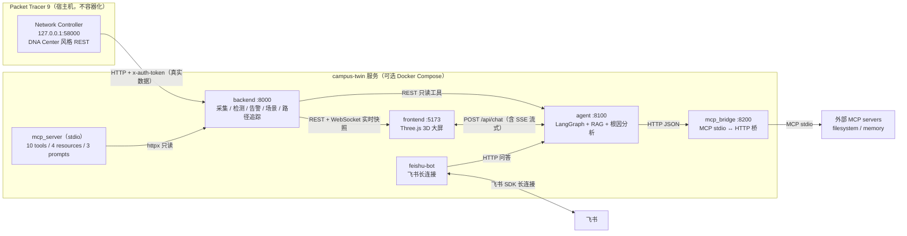

# 校园网络数字孪生运维平台（Campus Twin）

面向校园网络运维场景的数字孪生监控与智能排障系统。以 **Cisco Packet Tracer 9 的 Network Controller
北向 REST API 为真实数据源**，实现「采集 → 检测 → 归因 → 建议 → 验证」的运维闭环，
配 Three.js 三维可视化与**可切换大模型**的 AI 运维 Agent。

> 一句话：**一个接真实网络数据、能检测故障、能 AI 定位根因的校园网络运维平台。3D 只是它的仪表盘。**

> 📦 **作品集仓库（截图 / PDF 作品集 / 面试手册）**：https://github.com/zz-147/campus-twin-portfolio

[](https://github.com/zz-147/campus-twin/actions/workflows/ci.yml)


---

## 系统架构（4 个服务 + 1 个仿真源）

```
┌──────────────── 数据源：Packet Tracer 9 ────────────────┐
│  校园网络仿真（Core-3650 / 3×2960 / Router-4331 + 6 终端）│
│  Network Controller  →  Real World Access  →  :58000     │
│  REST API：/network-device /topology /host               │
│           /assurance/health-issues /flow-analysis         │
└──────────────────────────┬───────────────────────────────┘
                           │ HTTP + x-auth-token
┌──────────────────────────▼───────────────────────────────┐
│ 采集与检测后端  :8000（Python / FastAPI / httpx / SQLite）│
│  · 5s 周期采集，驱动可插拔（netcon / simulator / replay）  │
│  · 7 条检测规则 + 告警 incident 生命周期 + 降噪 + TTL     │
│  · observed_at / source_ts 双时间基准                     │
│  · REST + WebSocket 实时推送                              │
└─────────────┬────────────────────────────┬───────────────┘
              │ REST/WS                     │ REST（只读工具）
┌─────────────▼───────────────┐  ┌──────────▼────────────────┐
│ 3D 可视化大屏 :5173          │  │ AI 运维 Agent :8100        │
│ Three.js 4 楼栋/12 标记      │  │ 8 个真实数据工具            │
│ 告警脉冲/详情/实时状态       │  │ function calling 根因分析   │
│ AI 对话面板（接入 8100）     │  │ provider 可切换（DeepSeek…）│
└─────────────────────────────┘  └───────────────────────────┘
```

### 运行架构（Mermaid，含端口与数据流）



> 真实数据链路是 **PT Network Controller → backend**；其余服务围绕它做可视化、AI 排障、
> MCP 工具与机器人接入。Docker Compose 见「快速启动 · 方式 B」，PT NC 不在容器内（原因见
> [部署与 CI](docs/部署与CI.md)）。

## 快速启动（方式 A：本机直跑，4 步）

```powershell
# 0) Packet Tracer 9 打开 pt\campus-final.pkt，NC 设备开启 Real World Access（端口 58000）

# 1) 后端（采集+检测）
cd D:\zdsh\campus-twin\backend
D:\zdsh\campus-twin\.venv\Scripts\python.exe -m uvicorn app.main:app --port 8000

# 2) AI Agent（读取 agent\.env 的模型配置）
cd D:\zdsh\campus-twin\agent
D:\zdsh\campus-twin\.venv\Scripts\python.exe -m uvicorn app.api:app --port 8100

# 3) 前端大屏
cd D:\zdsh\campus-twin\frontend
npm run dev -- --port 5173

# 4) 打开 http://127.0.0.1:5173/
```

> 模型切换：编辑 `agent\.env` 的 `LLM_PROVIDER / LLM_BASE_URL / LLM_MODEL / LLM_API_KEY`
> 即可在 DeepSeek / OpenAI / Ollama / mock（离线规则）之间切换，无需改代码。

### 方式 B：Docker Compose（一键启动，⚠️ 本机未安装 Docker，未实测）

已提供根目录 `docker-compose.yml` + 4 个 Dockerfile（backend / agent / frontend / mcp_bridge），
已通过 YAML/路径/端口/依赖静态校验，但**未在本机执行 build/run**（本机无 Docker），
细节、环境变量与未实测项见 [部署与 CI](docs/部署与CI.md)。

```powershell
cd D:\zdsh\campus-twin
docker compose up -d --build
# 打开 http://127.0.0.1:5173/
# 端口：8000 backend / 8100 agent / 5173 frontend / 8200 mcp_bridge
docker compose down
```

> 容器内默认 `DRIVER=simulator`：PT Network Controller 只监听宿主机 `127.0.0.1:58000`，
> 容器无法直接访问；**真实 NC 数据请用上面的本机直跑方式**。
> compose 不写任何真实密钥，`LLM_API_KEY` 等通过环境变量或根目录 `.env` 注入，默认
> `LLM_PROVIDER=mock` 可离线演示。

## 安全与密钥（重要）

- **本仓库不包含任何 API Key**：`agent/.env`（真实密钥）已被 `.gitignore` 排除，仅本地存在；仓库里只有 `agent/.env.example` 占位模板。
- 复现时自行创建 `agent/.env`（参考 `.env.example`），填入自己的 `LLM_API_KEY`；代码只从环境变量/`.env` 读取密钥，绝不硬编码。
- 仓库同样排除：运行数据库（`backend/data`、`agent/data`、`mcp_bridge/data`）、日志、本地虚拟环境（`.venv*`）、`node_modules`、自动生成的临时截图。
- PT 实验环境口令（`admin/cisco`、设备 enable 口令等）仅为本地 Packet Tracer 模拟器实验配置，与真实生产凭据无关。
- 若发现密钥误提交，请立刻在 DeepSeek/OpenAI 控制台吊销并轮换。

## 数据真实性说明

| 数据 | 来源 | 真实性 |
|---|---|---|
| 设备清单 / 型号 / IOS 版本 | NC `GET /network-device` | ✅ 真实 |
| 物理拓扑（节点+链路+端口） | NC `GET /topology/physical-topology` | ✅ 真实 |
| 主机/终端清单与 ping 状态 | NC `GET /host` | ✅ 真实 |
| 健康问题/告警 | NC `GET /assurance/health-issues` + 自建规则 | ✅ 真实 |
| 接口流量/CPU/温湿度时序 | 行为仿真引擎（PT 不暴露计数器） | ⚠️ 仿真，显式标注 `source=simulator` |

**面试标准回答**：PT 的 Network Controller 提供 Cisco DNA Center 风格北向 REST API，
拓扑/设备/主机/健康问题是仿真网络真实运行状态；只有 PT 不暴露的接口计数器等指标由行为仿真引擎生成，
代码与前端均显式标注来源。

## 目录结构

```
campus-twin/
├─ .github/workflows/ci.yml  GitHub Actions 6 job 离线 CI（backend/agent/mcp/feishu/frontend）
├─ docker-compose.yml  Docker Compose 一键启动（4 服务，⚠️ 本机未实测）
├─ backend/          采集+检测服务（FastAPI :8000，171 tests）
├─ agent/            AI 运维 Agent（FastAPI :8100，256 tests，38 场景评测）
├─ mcp_server/       对外 MCP Server（stdio，10 tools/4 resources/3 prompts）
├─ mcp_bridge/       MCP Client 桥（filesystem/memory → Agent，:8200）
├─ feishu-bot/      飞书机器人（长连接双向接入，Node.js，无需公网）
├─ frontend/         Three.js 3D 大屏（Vite :5173）
├─ configs/          各网络设备配置（Core-3650 / SW-* / Router-4331）
├─ docs/             设计/实验/演示/总结文档
├─ tools/            NC 探针、一键初始化、故障监控脚本
├─ data/raw/         NC API 真实响应样本
├─ pt/               Packet Tracer 工程（campus-final.pkt）
└─ logs/             运行日志
```

## 文档索引

| 文档 | 内容 |
|---|---|
| [校园网络拓扑设计](docs/校园网络拓扑设计.md) | 拓扑/布线/IP 规划 + 实际落地记录 |
| [PT 环境配置清单](docs/PT环境配置清单.md) | PT 侧配置步骤 |
| [故障注入实验记录](docs/故障注入实验记录.md) | 真实故障闭环实验与暴露的问题 |
| [演示脚本](docs/演示脚本.md) | 3 分钟 / 5 分钟演示流程 + 翻车预案 |
| [录屏演示脚本](docs/录屏演示脚本.md) | 录屏分镜/台词/工具/翻车预案 + 一键启动命令 |
| [面试问答手册](docs/面试问答手册.md) | 436 行 / 55 题：自我介绍、项目讲解模板、8 类高频题、压力应对、反问清单 |
| [W9 Agent 扩展设计](docs/W9-Agent扩展设计.md) | 多 Agent / 场景自动化 / 数据管理契约 |
| [W10 路径追踪告警聚合设计](docs/W10-路径追踪告警聚合设计.md) | 路径追踪 / 告警根因分组 / Webhook / SNMP 驱动契约 |
| [MCP 接入说明](docs/MCP接入说明.md) | MCP Server（对外）+ MCP Client 桥接（对内）架构、配置、安全、验证 |
| [部署与 CI](docs/部署与CI.md) | 本机/Docker Compose/Actions CI、PT NC 容器边界、静态校验与未实测项 |
| [飞书机器人接入](docs/飞书机器人接入.md) | 长连接双向接入：飞书里问 AI/查网络；白名单+限流+去重；写操作不执行 |
| [作品集截图](docs/作品集.md) | 18 张真实运行截图（PT 拓扑/大屏/AI/路径追踪/MCP/架构图/评测数据）+ 使用建议 |
| [作品集 PDF](docs/校园网络数字孪生运维平台-作品集.pdf) | 15 页深色主题作品集（PPTX 源文件同目录），面试投屏/附件可直接用 |
| [进度交接与明日计划](docs/进度交接与明日计划.md) | 阶段进度与待办 |

## 里程碑

| 阶段 | 状态 |
|---|---|
| W1 环境+拓扑+后端 MVP | ✅ 5 台网络设备全 Managed，拓扑 5 节点/4 链路 |
| W2 前端 3D 大屏 | ✅ 4 楼栋/12 标记/实时数据/告警脉冲 |
| W3 检测引擎 | ✅ 7 规则 + 恢复判定 + 降噪 + 时间基准（96 tests） |
| W3 故障注入实测 | ✅ shutdown → critical 告警 → 恢复（见实验记录） |
| W5-6 AI Agent | ✅ 8 工具 + provider 可切换 + 20 场景评测：**真实 DeepSeek 根因 100% / 设备定位 100%**（67 tests） |
| W7 AI 对话面板 | ✅ 三页签信息坞 + AI 助手（真实问答/离线降级）+ 数据新鲜度 + 告警生命周期（冒烟 PASS） |
| W9 演示录屏/文档 | 🚧 收尾中（演示脚本与项目文档已完成） |
| **W9 多 Agent + 场景自动化 + 数据管理** | ✅ 1 主 + 4 子 Agent、自动发现新设备并加入 3D 场景、告警/对话删除（按钮 + Agent action 确认）、审计（后端 129 tests / Agent 147 tests / 30 场景评测 100%） |
| **W10 路径追踪 / 告警根因分组 / Webhook / SNMP 驱动** | ✅ NC flow-analysis 真实路径 4 跳 + 3D 发光路径/断点、告警根因分组与抑制、Webhook 通知（本地接收器实测）、SNMP 可插拔驱动（后端 171 tests / Agent 174 tests / 35 场景评测 100%） |
| **W11 LangGraph 编排引擎** | ✅ StateGraph 节点+条件边、SqliteSaver checkpointer（多轮续聊/重启可恢复）、`interrupt()` 人机中断（写操作暂停图→确认后 resume）；classic 引擎可一键回退（Agent 192 tests，两引擎评测均 100%） |
| **W12 SSE 流式 + 轻量 RAG** | ✅ `/api/chat/stream` 逐 token SSE（真实 LLM 2600+ token 事件）+ 前端逐字渲染/停止生成；18 知识块 BM25-lite 检索 + `[K1]` 引用 + 无命中不编造（Agent 207 tests，38 场景 100%） |
| **W13 MCP 双向集成** | ✅ 自建 **MCP Server**（10 tools / 4 resources / 3 prompts，Claude Desktop/Cursor 可接入）+ **MCP Client 桥接**（filesystem/memory 23 工具 → Agent）；256 Agent tests，只读白名单 + 审计 |
| **W14 飞书机器人** | ✅ 长连接双向接入：飞书群里「状态 / 告警 / 路径 / 读配置 / 任意问答」；白名单 + 限流 + 去重 + 写操作只提示不执行；19 项离线自测通过 |
| **W15 P2 可部署性 / CI / 架构图** | ✅ 4 个 Dockerfile + `docker-compose.yml`（8000/8100/5173/8200，healthcheck + depends_on）+ 6 job 离线 Actions CI + README Mermaid 架构图；⚠️ 本机无 Docker，Compose/CI 仅静态校验（部署说明见 docs/部署与CI.md） |
