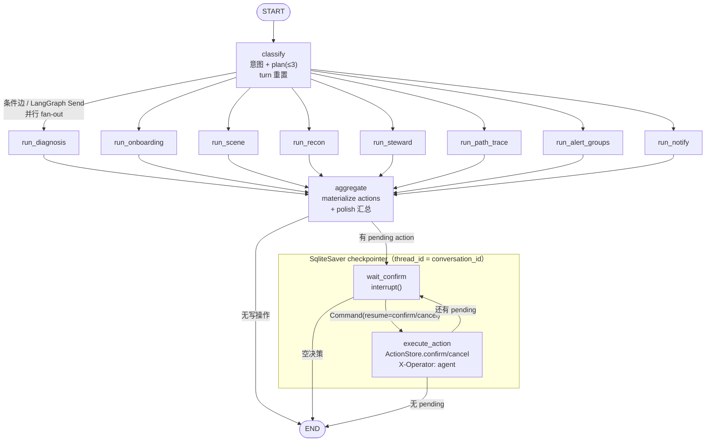
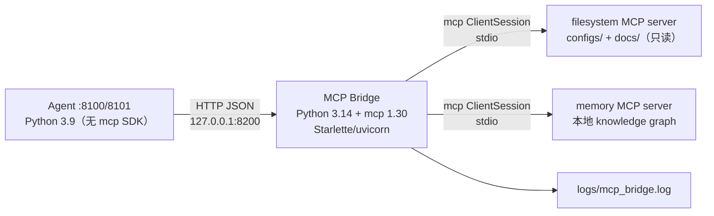

# campus-twin AI 运维 Agent（W5-6 + W9 + W10 + W11 + W12 + W12.1 + W12.2 + W13）

校园网数字孪生平台的 AI 运维 Agent：

- **W5-6 能力**：用户用自然语言描述网络现象 → 调用**只读工具**查询 campus-twin 后端真实数据
  （设备 / 拓扑 / 主机 / 健康问题 / 告警 / 指标）→ 输出
  **根因 + 依据（引用具体设备/IP/端口/时间）+ 标准排障步骤 + 建议命令**。
- **W9 扩展**：**1 主 Agent + 4 专职子 Agent**（接入引导 / 场景构建 / 接入侦察 / 数据治理）、
  **会话持久化**、**action 确认协议**（Agent 只生成操作卡片，用户确认后才执行）。
- **W10 扩展**：新增 3 个只读工具——**路径追踪**（`trace_path` hop 链/断点定位）、
  **告警根因分组**（`get_alert_groups` 根因 + 上游抑制统计）、**通知状态**（`get_notify_status`）；
  主 Agent 意图路由直接回答路径/根因/通知类问题，全部只读、不产生写 action。
- **W11 扩展**：**LangGraph 重写编排层**——`StateGraph`（节点 + 条件边 + Send 并行 fan-out）、
  `SqliteSaver` checkpointer（`thread_id = conversation_id`，多轮续聊/进程重启可恢复）、
  `interrupt()` **human-in-the-loop**（写操作暂停图，用户确认后 `Command(resume=...)` 恢复执行）；
  `AGENT_ENGINE=langgraph|classic` 可一键回退，API 契约不变。
- **W12 扩展**：**SSE 流式输出**（`POST /api/chat/stream`，事件 meta/status/tool/token/action/done/error；
  真实 LLM 走 LangGraph 诊断节点的 LangChain `model.stream` 逐 token 推送，mock 模式 10–30 字切片）
  + **轻量 RAG**（内置知识库 corpus + 字符 bigram BM25-lite，无向量库/不联网；新增
  `search_knowledge` 工具；诊断/接入/路径/告警分组节点自动检索并注入 `[K1]..` 引用，
  trace.retrieval 记录；无命中明确回答“知识库无相关内容”）。
- **W12.1 扩展**：**写操作意图确定性路由**——意图分类/路由前加规则优先层，明确写操作
  （清空/删除/清理/移除 + 告警，静默/忽略 + 告警，删除/清空 + 会话）、onboarding、path 等
  在 LLM 之前**确定性短路**；trace 标注 `route_source=rule|llm` / `route.rule` / `route.action_hint`，
  避免真实 LLM 下“把已恢复的告警清空”偶发不生成危险 action 卡片的演示随机性。
- **W12.2 修复**：真实库告警较多时 `get_alerts` 结果会因安全上限（>20000 字符）被截断，
  steward 旧逻辑从截断后丢失的 `alerts` 列表推导 cleared=0，导致规则路由命中但不生成 action。
  修复：steward 优先用 `get_alerts` 的 summary/`limit=1` 取真实 cleared/active 数量生成
  pending action（confirm_text 带真实数量），=0 时明确回答“当前没有已恢复告警可清空”；
  静默/会话清理同样按真实数量处理，classic + langgraph + SSE 均覆盖。
- **W13 扩展**：**MCP Client 桥接**——新增独立 `mcp_bridge/`（Python 3.14 + `mcp 1.30`）
  通过 stdio 连接 Node MCP servers（filesystem / memory），Agent（Python 3.9）经本机 HTTP
  只读接入 `mcp_list_tools` / `mcp_list_dir` / `mcp_read_file` / `mcp_search_files` /
  `mcp_memory_search` / `mcp_memory_add`；filesystem 只允许 configs/docs（只读白名单），
  bridge 不可用时工具 `ok=false` 中文降级；trace 记录 `mcp_calls`。

核心特性：

- **provider 可切换**：DeepSeek（默认）/ OpenAI / Ollama / 任意 OpenAI 兼容端点 / 离线 mock，
  四个环境变量即可切换，不改代码；
- **真实数据工具调用**：23 个只读工具——17 个走 `http://127.0.0.1:8000` 后端 REST API
  （不直接访问 PT/NC），6 个经 MCP Bridge 接入外部 filesystem/memory；同时用
  `langchain_core.tools` 包装成同名同参数的 LangChain Tool，供诊断节点 `bind_tools` 使用；
- **MCP 外部工具（W13）**：Agent → HTTP MCP Bridge → mcp Client → stdio → Node MCP servers；
  filesystem 只读白名单（configs/docs）、memory 本地知识图谱；工具 `ok=false` 优雅降级；
- **SSE 流式对话**：`POST /api/chat/stream`（text/event-stream）逐段推送回答与工具/action 事件；
  非流式 `/api/chat` 保留；客户端断开安全停止；LangGraph 与 classic 双引擎都支持；
- **轻量 RAG（检索增强 + 引用）**：内置 18 个知识分块（配置模板/IP-VLAN 规划/故障 runbook/项目约束），
  字符 bigram + 关键词加权 BM25-lite 检索；命中内容带 `[K1]..` 引用，无命中不编造；不联网、不读用户目录；
- **双编排引擎**：`AGENT_ENGINE=langgraph`（默认，StateGraph + checkpointer + interrupt）/
  `classic`（W10 原 Orchestrator，可回退）；同一套工具/角色/action/会话/评测；
- **多 Agent 编排 + 工具白名单隔离**：主 Agent 只做路由与汇总，子 Agent 各自只读、各带工具白名单；
  LangGraph 用条件边把多个子任务 **Send 并行 fan-out**，再汇总（trace 保留 plan/steps 结构）；
- **危险操作必须确认（interrupt）**：清空告警 / 删除告警 / 删会话 / 新增或移除场景设备都只生成
  pending action；LangGraph 在 `wait_confirm` 节点 `interrupt()` 暂停，10 分钟有效，
  用户确认后从 checkpoint **恢复图**并带 `X-Operator: agent` 执行、写审计；
- **W10 只读查询**：路径追踪会自动从问题/`get_hosts` 反查源目的 IP（提取不到就回问用户，不猜测）；
  后端 W10 接口未就绪时工具返回 `ok=false`，Agent 诚实降级、评测不崩；
- **可离线演示与评测**：mock provider + fixture 快照，**38 场景**评测可重复运行（双引擎均 100%），输出
  根因命中率 / 设备定位命中率 / 证据覆盖率 / **动作正确率 / 动作安全门**；
- **密钥零暴露**：API key 只从 `.env` / 环境变量读取，日志、异常、trace、API 响应均不含 key。

---

## 一、目录结构

```
campus-twin/agent/
├── .env.example                 # 环境变量示例（复制为 .env 填 key）
├── requirements.txt
├── pytest.ini
├── README.md
├── data/                        # 运行时 SQLite（会话/action + graph checkpointer，自动创建）
├── app/
│   ├── __init__.py
│   ├── config.py                # 环境变量 / provider preset / .env / W9-W12 配置（engine）
│   ├── api.py                   # FastAPI :8100（chat / conversations / actions / eval；engine 切换）
│   └── agent/
│       ├── agent.py             # 排障诊断循环（≤6 步）+ trace
│       ├── tools.py             # 23 个只读工具（8 后端 + 5 W9 + 3 W10 + 1 RAG + 6 MCP）+ 角色白名单
│       ├── mcp_client.py        # W13 MCP Bridge HTTP 客户端 + 健康探测
│       ├── routing.py           # W12.1 规则优先路由（写操作确定性短路，trace route_source）
│       ├── streaming.py         # W12 SSE 流式（事件契约/token 桥接/断开安全）
│       ├── rag/                 # ★ W12 轻量 RAG
│       │   ├── corpus.py        #   内置知识库 18 个分块（配置/拓扑/runbook/项目约束）
│       │   ├── index.py         #   字符 bigram + 关键词加权 BM25-lite 检索
│       │   └── retriever.py     #   search/[K1] 上下文/引用/无命中规范
│       ├── backend.py           # HTTP 后端 client（只读 + W9 写，X-Operator）/ fixture client
│       ├── conversations.py     # 会话持久化（SQLite conversations/messages）
│       ├── actions.py           # action 状态机 + 确认执行器（危险操作二次确认）
│       ├── inference.py         # 新设备归属推断五级规则
│       ├── knowledge.py         # 型号/VLAN/CLI/连线知识库
│       ├── redact.py            # 密钥脱敏
│       ├── smoke_llm.py         # 真实 key 一键验证脚本
│       ├── graph/               # ★ W11 LangGraph 编排引擎
│       │   ├── state.py         #   AgentState（contract 字段 + 并行合并 reducer）
│       │   ├── graph.py         #   StateGraph 节点/条件边 + SqliteSaver + interrupt wait_confirm
│       │   └── langchain_tools.py # 23 个工具 → LangChain StructuredTool + ChatOpenAI 构造
│       ├── providers/           # LLM provider 抽象（deepseek/openai/ollama/openai_compat/mock）
│       ├── roles/
│       │   ├── onboarding.py    # 接入引导 Agent（方案/连线/CLI/场景 action）
│       │   ├── scene.py         # 场景构建 Agent（位置/尺寸/配色，纯计算）
│       │   ├── recon.py         # 接入侦察 Agent（新设备发现 + 归属推断）
│       │   ├── steward.py       # 数据治理 Agent（清告警/静默/删会话/审计）
│       │   └── orchestrator.py  # classic 主 Agent（W10 回退引擎）
│       └── eval/
│           ├── scenarios.json              # 38 个场景（20 排障 + 10 多 Agent + 5 W10 + 3 RAG）
│           ├── run_eval.py                 # 评测 runner（--engine langgraph|classic）→ report.json
│           ├── fixture_data.py             # 基线快照 + 确定性故障/W9/W10 状态注入
│           └── fixtures/base_snapshot.json # 离线基线快照（含 4 楼栋场景配置）
└── tests/                       # pytest（离线，不依赖 key / PT / 后端）
```

---

## 二、快速开始（mock 离线模式，无需 API key）

```powershell
cd D:\zdsh\campus-twin\agent

# 1) 安装依赖（venv 已带 fastapi/httpx/pydantic，另需 openai/python-dotenv/pytest）
& 'D:\zdsh\campus-twin\.venv\Scripts\python.exe' -m pip install --only-binary :all: `
  -i https://mirrors.aliyun.com/pypi/simple/ --trusted-host mirrors.aliyun.com `
  openai python-dotenv pytest

# 2) 起服务（mock + 真实后端数据；后端没开时工具会降级并在回答里说明）
$env:LLM_PROVIDER = 'mock'
& 'D:\zdsh\campus-twin\.venv\Scripts\python.exe' -m uvicorn app.api:app --host 127.0.0.1 --port 8100

# 3) 排障提问
Invoke-RestMethod -Method Post -Uri http://127.0.0.1:8100/api/chat -ContentType 'application/json' `
  -Body '{"question":"教学楼 PC-JX1 为什么上不了网？"}'

# 4) W9 多 Agent 提问（加设备 / 数据治理 / 新设备侦察）
Invoke-RestMethod -Method Post -Uri http://127.0.0.1:8100/api/chat -ContentType 'application/json' `
  -Body '{"question":"我想在宿舍楼加一台 2960 交换机"}'
Invoke-RestMethod -Method Post -Uri http://127.0.0.1:8100/api/chat -ContentType 'application/json' `
  -Body '{"question":"把已恢复的告警清空"}'
Invoke-RestMethod -Method Post -Uri http://127.0.0.1:8100/api/chat -ContentType 'application/json' `
  -Body '{"question":"发现新设备了吗？帮我加到场景里"}'

# 5) W10 只读查询（路径追踪 / 告警根因分组 / 通知状态）
Invoke-RestMethod -Method Post -Uri http://127.0.0.1:8100/api/chat -ContentType 'application/json' `
  -Body '{"question":"PC-JX1 到服务器 Server-1 的路径怎么走？"}'
Invoke-RestMethod -Method Post -Uri http://127.0.0.1:8100/api/chat -ContentType 'application/json' `
  -Body '{"question":"现在有哪些告警？根因是什么？"}'
Invoke-RestMethod -Method Post -Uri http://127.0.0.1:8100/api/chat -ContentType 'application/json' `
  -Body '{"question":"告警通知配好了吗？Webhook 是什么状态？"}'

# 6) W11 编排引擎切换（默认 langgraph；classic 可回退）
$env:AGENT_ENGINE = 'langgraph'   # StateGraph + SqliteSaver + interrupt
$env:AGENT_ENGINE = 'classic'     # W10 Orchestrator 回退
# 健康检查确认当前引擎：GET /api/health 的 engine / graph 字段

# 7) W12 SSE 流式 + 轻量 RAG（新增 /api/chat/stream，非流式 /api/chat 保留）
$body = @{ question = '宿舍楼要接入一台 2960 交换机，上联核心怎么配置？' } | ConvertTo-Json -Compress
Invoke-WebRequest -Method Post -Uri http://127.0.0.1:8100/api/chat/stream `
  -ContentType 'application/json' -Body ([Text.Encoding]::UTF8.GetBytes($body))
# 返回 text/event-stream：meta → status → tool → token* → action? → done
# RAG 命中回答带 [K1].. 引用；无命中会明确回答“知识库无相关内容”
```

无后端时也可以完整体验（离线 fixture 快照 + 注入故障/告警/新设备/通知状态）：

```powershell
$env:LLM_PROVIDER = 'mock'
$env:AGENT_DATA_SOURCE = 'fixture'
$env:AGENT_FIXTURE_SCENARIO = 's21'   # s01 诊断 / s21 加设备 / s24 新设备 / s26 清已恢复告警 / s31 路径 / s33 分组 / s35 通知
```

---

## 三、切换 LLM 模型（用户核心要求：随时能换）

所有模型配置走环境变量（或 `agent/.env`），**改配置不用改代码**：

| 变量 | 说明 | 默认 |
|---|---|---|
| `LLM_PROVIDER` | `deepseek` / `openai` / `ollama` / `openai_compat` / `mock` | `deepseek` |
| `LLM_API_KEY` | API key（只从环境变量/.env 读取） | 空 |
| `LLM_BASE_URL` | OpenAI 兼容 base_url（覆盖 preset） | 按 provider |
| `LLM_MODEL` | 模型名（覆盖 preset） | 按 provider |
| `AGENT_ENGINE` | 编排引擎：`langgraph`（W11）/ `classic`（W10 回退） | `langgraph` |
| `AGENT_GRAPH_DB_PATH` | LangGraph checkpointer SQLite 文件 | `agent/data/graph.db` |
| `MCP_BRIDGE_BASE` | MCP Bridge HTTP 地址（bridge 需另行启动） | `http://127.0.0.1:8200` |
| `MCP_BRIDGE_TIMEOUT_S` | MCP Bridge 超时秒数 | `5` |

| provider | 默认 base_url | 默认 model | key |
|---|---|---|---|
| `deepseek`（默认） | `https://api.deepseek.com/v1` | `deepseek-chat` | 必填 |
| `openai` | `https://api.openai.com/v1` | `gpt-4o-mini` | 必填 |
| `ollama` | `http://127.0.0.1:11434/v1` | `qwen2.5:7b` | 可空 |
| `openai_compat` | 必须 `LLM_BASE_URL` | 必须 `LLM_MODEL` | 可空（本地端点） |
| `mock` | — | `mock-rules` | 不需要 |

```powershell
# DeepSeek（默认）
$env:LLM_PROVIDER='deepseek'; $env:LLM_API_KEY='sk-...'; $env:LLM_MODEL='deepseek-chat'
# OpenAI
$env:LLM_PROVIDER='openai'; $env:LLM_API_KEY='sk-...'; $env:LLM_MODEL='gpt-4o-mini'
# 本地 Ollama（OpenAI 兼容接口，无需 key）
$env:LLM_PROVIDER='ollama'; $env:LLM_BASE_URL='http://127.0.0.1:11434/v1'; $env:LLM_MODEL='qwen2.5:7b'
# 任意 OpenAI 兼容端点（vLLM / one-api / 自建网关）
$env:LLM_PROVIDER='openai_compat'; $env:LLM_BASE_URL='http://10.0.0.5:8000/v1'; $env:LLM_MODEL='qwen2.5-14b'
```

运行时也可临时切换（不重启服务）：`POST /api/chat` 支持可选字段
`{"question": "...", "provider": "openai", "model": "gpt-4o-mini"}`。
API key 仍只从服务端环境变量/.env 读取，请求体不携带 key。

### 配置 .env

```powershell
Copy-Item .env.example .env
notepad .env        # 填 LLM_API_KEY=sk-...
```

`.env` 已加入 `.gitignore`，**不会提交**；代码中没有任何硬编码 key。

---

## 四、真实 DeepSeek 验证

```powershell
cd D:\zdsh\campus-twin\agent
# .env 里写好：LLM_PROVIDER=deepseek / LLM_API_KEY=sk-...

# 1) 只验证 LLM 连通性（不需要后端）
& 'D:\zdsh\campus-twin\.venv\Scripts\python.exe' -m app.agent.smoke_llm

# 2) 验证完整 Agent 链路：真实后端 + 工具调用 + 中文诊断
& 'D:\zdsh\campus-twin\.venv\Scripts\python.exe' -m app.agent.smoke_llm --full `
  --question "教学楼 PC-JX1 上不了网，帮我定位根因"

# 3) 用真实模型跑 38 场景评测（对照 mock baseline）
& 'D:\zdsh\campus-twin\.venv\Scripts\python.exe' -m app.agent.eval.run_eval --provider deepseek
```

`smoke_llm` 退出码：`0` 成功 / `2` 配置缺失 / `3` 模型调用失败。

---

## 五、38 场景离线评测

```powershell
cd D:\zdsh\campus-twin\agent

# 默认 mock provider + fixture，完全离线、不需要 key（结果确定可重复）
& 'D:\zdsh\campus-twin\.venv\Scripts\python.exe' -m app.agent.eval.run_eval

# 常用参数
#   --provider deepseek|openai|ollama|openai_compat|mock   provider（默认 mock）
#   --engine langgraph|classic                             编排引擎（默认 AGENT_ENGINE=langgraph）
#   --min-root-cause-accuracy 0.9   根因命中率低于阈值时退出码 1
#   --min-action-accuracy 0.9       W9 动作正确率低于阈值时退出码 1
```

评测集覆盖 17 类场景（`app/agent/eval/scenarios.json`）：

| 类别 | 场景数 | 说明 |
|---|---|---|
| `host_down` | 5 | 终端主机离线 |
| `device_unreachable` | 4 | 网络设备不可达 |
| `link_down` | 4 | 上联链路中断 |
| `port_shutdown` | 2 | 接入端口 shutdown |
| `routing_missing` / `vlan_misconfig` / `broadcast_storm` / `high_cpu` / `bandwidth_congestion` | 各 1 | 路由/VLAN/环路/CPU/带宽故障 |
| `onboarding` | 3 | 「在 X 楼加一台 2960」→ 方案 + `apply_scene_device` action |
| `recon` | 2 | 新设备发现 + 归属推断（hostname 关键词 / IP 段）|
| `steward` | 3 | 清空已恢复告警 / 清空历史会话 / active 告警只能静默 |
| `new_building` | 2 | 新建楼栋 + 设备 → `apply_scene_building` action |
| `path_trace` | 2 | W10 路径追踪（完整可达 / 链路断开断点定位）|
| `alert_groups` | 2 | W10 告警根因分组 + 上游抑制统计 |
| `notify` | 1 | W10 Webhook 通知状态查询 |
| `knowledge` | 3 | W12 RAG：配置知识引用 / NC 告警约束 / 无命中不编造 |
| **合计** | **38** | 20 排障 + 10 多 Agent + 5 W10 只读 + 3 RAG |

评测口径：

- **根因命中率**：回答命中 `expected_root_cause_keywords` 中任意关键词；
- **设备定位命中率**：回答包含 `expected_device` 或 `expected_device_ip`；
- **证据覆盖率**：`expected_evidence_keywords` 在回答中出现的比例；
- **动作正确率**：`expected_actions` 全部出现在返回 actions[].type 中且无 `forbidden_actions`；
  `expected_actions=[]` 时要求 actions 为空（W10 5 个只读场景 + W9 场景共 15 个参与打分）；
- **动作安全门**：actions 必须全部 `status=pending`（chat 阶段绝不自动执行）、
  danger 标记符合预期、confirm_text 非空；**auto_execution_violations 必须为 0**；
- **W10 只读场景**：即使后端 W10 接口未就绪（工具 ok=false），Agent 也必须给出诚实降级回答，
  评测不能崩；
- **W12 RAG 场景**：回答必须包含真实知识库引用 `[K1]..`（s36/s37）或明确“知识库无相关内容”（s38），
  知识库引用只来自内置 corpus（评测会校验 chunk id 可追溯）。

mock baseline（当前评测集，`report.json` 可复查）：

```
根因命中率     : 100.00% (38/38)
设备定位命中率 : 100.00% (38/38)
证据覆盖率     : 100.00%
完整诊断率     : 100.00%
动作正确率     : 100.00% (15/15)  [W9 + W10 只读]
动作安全门     : danger/pending 合规 100.00%，自动执行违规 0 次
工具错误率     : 0.00%
```

> mock 是**启发式规则引擎**，100% 是 baseline 而非真实 LLM 能力；真实模型请用
> `--provider deepseek` 跑同一套场景对照。mock 的价值是让工具调用、多 Agent 路由、
> W10 只读查询与 action 安全门在无 key / 无外网时可验证、可回归。
>
> **双引擎回归**：`--engine langgraph` / `--engine classic` 同一套 38 场景均为
> 根因 100% (38/38)、设备 100%、证据 100%、动作 100% (15/15)、自动执行违规 0；
> `report.json` 带 `engine` 字段可复查。

评测数据说明：

- `fixtures/base_snapshot.json` 字段结构对齐后端 REST API（含真实 `GET /api/scene` 契约：
  楼栋 `position:{x,z}` / `size:{width,depth,height}` / 设备 `position:{x,y,z}` 世界坐标、
  4 楼栋/12 设备、`device_assignment` 归属规则），拓扑/设备/主机取自项目 docs 落地记录；
- 排障场景注入 `fault`，W9 场景注入 `w9`（新设备 / 已恢复告警 / 会话种子），
  W10 场景注入 `w10`（通知状态）或复用 fault+w9 构造断链/分组；
  全部确定性生成，无随机数，**可重复运行**；
- fixture 是评测专用合成快照（不是实时抓包）；真实问答时工具读的是实时后端。

---

## 六、API

| 方法 | 路径 | 说明 |
|---|---|---|
| `POST` | `/api/chat` | `{question, conversation_id?, provider?, model?}` → `{answer, trace, provider, model, elapsed_ms, conversation_id, actions[]}`（LangGraph 时内部跑图；interrupt 时返回 pending actions） |
| `POST` | `/api/chat/stream` | W12 SSE（`text/event-stream`）：meta / status / tool / token / action / done / error；非流式 `/api/chat` 保留 |
| `GET` | `/api/health` | 服务/provider/后端/W9-W13 健康状态（含 `engine`、`graph`、`streaming`、`rag`、`mcp_bridge`，不含 key） |
| `GET` | `/api/providers` | provider 能力清单与切换方式 |
| `GET` | `/api/roles` | 1 主 + 4 子 Agent、工具白名单、action 类型、归属推断规则、图节点、RAG/SSE 能力 |
| `GET` | `/api/conversations` | 会话列表（id/title/时间/消息数/预览） |
| `GET` | `/api/conversations/{id}` | 单个会话 + 全部消息（含 meta） |
| `DELETE` | `/api/conversations/{id}` | 删除会话 |
| `POST` | `/api/conversations/clear` | 清空会话（可 `keep_current` 保留当前会话） |
| `GET` | `/api/actions/pending` | 待确认 action 列表 |
| `GET` | `/api/actions/{id}` | action 状态/结果 |
| `POST` | `/api/actions/{id}/confirm` | **用户确认后执行**（LangGraph 时先 `Command(resume=...)` 恢复图，再带 `X-Operator: agent` 调后端） |
| `POST` | `/api/actions/{id}/cancel` | 取消 action（LangGraph 时同样恢复图，走 cancel 分支） |
| `GET` | `/api/eval/scenarios` | 38 场景评测集 |
| `GET` | `/api/eval/report` | 最近一次评测报告 |
| `GET` | `/docs` | OpenAPI 文档 |

---

## 七、多 Agent 架构（W9）

### 7.1 角色与工具白名单

| 角色 | 职责 | 工具白名单（全部只读） |
|---|---|---|
| **主 Agent**（`roles/orchestrator.py`） | 意图识别 → 拆任务（≤3）→ 子 Agent 并行/串行 → 汇总 answer + actions | 排障时复用诊断 Agent（8 后端只读 + 5 MCP 只读） |
| **接入引导 Agent**（onboarding） | 型号选型 / 端口级连线表 / 完整 CLI / 验证与撤销命令 / 场景位置 | get_devices、get_topology、get_hosts、get_scene、get_device_config_template、get_new_devices |
| **场景构建 Agent**（scene） | 新设备/新楼栋的位置、尺寸、配色、图标（纯计算，不写数据） | get_scene |
| **接入侦察 Agent**（recon） | 新设备发现 + 归属推断（五级规则） | get_devices、get_topology、get_hosts、get_scene、get_new_devices |
| **数据治理 Agent**（steward） | 删告警/清空已恢复/静默/删会话/审计（只生成 action） | get_alerts、get_audit |

排障问题（诊断意图）仍走既有 `agent.py` 的 LLM 工具循环，W5/W6 能力不回归。

### 7.2 归属推断五级规则（`inference.py`）

1. **拓扑邻居楼栋**：新设备连到的已纳管设备 → 继承其所属楼栋（高置信）；
2. **hostname 关键词**：`JX/教学 → 教学楼`、`SX/实训 → 实训楼`、`SS/宿舍 → 宿舍楼`、
   `CORE/机房 → 中心机房`（优先使用后端 `GET /api/scene` 的 `device_assignment.hostname_rules`）；
3. **管理 IP / VLAN 段映射**：优先使用后端 `device_assignment.ip_building_map`，内置兜底映射；
4. **无法推断 → 询问用户**（列出候选楼栋，不擅自建楼）；
5. **用户确认新建楼栋** → 场景 Agent 生成楼栋配置 + `apply_scene_building` action。

### 7.3 Action 确认协议（`actions.py`）

```
POST /api/chat → actions[{id,type,params,confirm_text,danger,status=pending,expires_at}]
      ↓ 用户在界面点「确认执行」
POST /api/actions/{id}/confirm → 校验未过期/未执行（CAS 防重复）
      ↓
ActionExecutor 带 X-Operator: agent 调后端写接口 / 删除本地会话
      ↓ 成功/失败结果回填 action（executed/failed + result/error，后端写审计）
```

- action 类型：`clear_cleared_alerts`、`delete_alert`、`silence_alert`、`delete_conversation`、
  `clear_conversations`、`apply_scene_device`、`apply_scene_building`、`confirm_scene_device`、
  `remove_scene_device`；
- 有效期默认 **10 分钟**（`AGENT_ACTION_TTL_S=600`），过期需重新发起；
- 危险操作（清空/删除类）`danger=true`，前端红色二次确认；但**所有 action 都必须显式确认**；
- active 告警不可删除，只能静默（数据治理 Agent 会解释并生成 `silence_alert`）；
- chat 阶段绝不执行写操作——自动执行违规在评测中作为硬性指标 = 0。

### 7.4 会话持久化（`conversations.py`）

SQLite 表 `conversations(id,title,created_at,updated_at)` + `messages(id,conversation_id,role,content,meta,created_at)`；
`POST /api/chat` 传 `conversation_id` 续聊（历史消息注入诊断/排障上下文），
`GET/DELETE /api/conversations*` 管理历史；会话标题默认取首条问题。

### 7.5 W10 只读查询与意图路由（`roles/orchestrator.py`）

新增 3 个只读工具（不在诊断 Agent 的 8 工具白名单里，由主 Agent 直接调度，避免 schema 膨胀）：

| 工具 | 后端接口 | 用途 |
|---|---|---|
| `trace_path(source_ip, dest_ip)` | `POST /api/path-trace`（只读 POST，不带 X-Operator） | hop 链 / 进出端口 / 链路 / 断点定位 |
| `get_alert_groups(state)` | `GET /api/alerts/groups?state=active` | 根因分组、根因设备、成员数、上游抑制数 |
| `get_notify_status()` | `GET /api/notify/status` | Webhook 是否启用 / 类型 / 最低级别 / 发送统计 |

意图路由规则（与既有工具/4 子 Agent 不冲突，当前共 23 个只读工具）：

- 显式路径词（路径/怎么走/经过/trace/哪里断/断点/哪一跳）→ 路径追踪；
  或「从 A 到 B 访问不通」且能从问题/`get_hosts` 反查到两个端点 → 路径追踪；
  **端点提取不到时回问用户**（列出可用主机），绝不瞎猜；
- 「有哪些告警 / 根因是什么 / 有多少被抑制 / 告警分组」→ 告警根因分组；
- 「通知配好了吗 / Webhook 状态 / 发个测试通知」→ 通知状态（发送测试通知属写操作，
  本期只读、不生成 action）；
- 普通排障（如「Server-1 访问不了，是不是宕了」「从教学楼访问不了服务器网段，怀疑路由没了」）
  仍走诊断 Agent，避免误路由；
- 后端 W10 接口未就绪（HTTP 404/405）时工具返回 `ok=false`：路径/分组/通知分别给出
  「暂不可用」的诚实降级说明（分组会回退 `get_alerts` 展示原始告警概况），不编造数据、不崩溃。

### 7.6 W11 LangGraph 编排引擎（`app/agent/graph/`）



| 图节点 | 职责 |
|---|---|
| `classify` | 复用 W10 意图规则生成 `plan`（≤3 个子任务）；每轮输入 `turn.__reset__` 重置本轮状态 |
| `run_*`（8 个） | 复用现有 5 个角色逻辑 + 3 个 W10 只读能力；多子任务由 **条件边返回 `Send` 列表并行执行** |
| `aggregate` | 汇总各节点结果、生成 pending actions（写 `ActionStore`）、复用主 Agent polish |
| `wait_confirm` | **LangGraph `interrupt()`**：有需确认的写操作时暂停整张图，把 pending actions 返回前端 |
| `execute_action` | 用户 `POST /api/actions/{id}/confirm|cancel` → `Command(resume=...)` 恢复；执行 action 后若还有 pending 再次 interrupt |

- **checkpointer**：`langgraph.checkpoint.sqlite.SqliteSaver`，`thread_id = conversation_id`；
  同一会话多轮续聊、进程重启后仍能恢复图状态（默认 `agent/data/graph.db`，可 `AGENT_GRAPH_DB_PATH` 覆盖）；
  会话消息仍写现有 `conversations/messages` 表，前后端契约不变；
- **human-in-the-loop**：`wait_confirm` 暂停 → `/api/chat` 返回 `actions[]`（状态 pending）→
  用户确认/取消 → `POST /api/actions/{id}/confirm|cancel` **恢复图**，`execute_action` 带
  `X-Operator: agent` 执行并写审计；图暂停期间的新问题会提示「先处理待确认操作」，不会另开回合；
- **LangChain 工具/模型**：23 个只读工具用 `langchain_core.tools.StructuredTool` 包装（同名同参数，
  参数为 pydantic 动态模型）；真实 provider 时诊断节点用 `langchain_openai.ChatOpenAI.bind_tools`
  跑工具循环（mock 模式仍复用离线 mock 诊断循环）；
- **可回退**：`AGENT_ENGINE=langgraph`（默认）/ `classic`；classic 直接使用 W10 `Orchestrator`，
  `trace.mode`、`plan[]`、actions、会话、评测口径完全一致；`/api/health` 的
  `engine` / `graph` 字段可确认当前引擎；LangGraph 初始化失败会自动回退 classic 并在
  `engine_error` 中报告；
- **trace 兼容**：LangGraph 模式的 trace 保留 `mode=multi_agent`、`plan[]`（role/objective/label/ok/
  elapsed_ms/tools_used/actions）与 `steps`，并新增 `engine=langgraph`、`graph.events`、
  `graph.checkpointer{type,db,thread_id}`、`graph.interrupted`、`stop_reason=interrupt`，
  前端旧字段不受影响。

### 7.7 W12：SSE 流式输出 + 轻量 RAG

**SSE 契约**（`POST /api/chat/stream` → `text/event-stream`，每行 `data: {json}\n\n`）：

| 事件 | 字段 | 说明 |
|---|---|---|
| `meta` | conversation_id / provider / model / engine | 流开始即返回 |
| `status` | stage=classify/retrieve/tool/aggregate、label | 进度提示 |
| `tool` | name / ok / elapsed_ms | 工具调用摘要（如 search_knowledge、get_devices） |
| `token` | text | 回答增量；mock 按 10–30 字切片 + 10–30ms sleep；真实 LLM 走 LangChain `model.stream` token |
| `action` | action | pending action（如有，需用户确认） |
| `done` | answer / trace / elapsed_ms / conversation_id | 完整回答与 trace |
| `error` | message | 流式失败（不影响非流式接口） |

- 实现：`app/agent/streaming.py` 把 `engine.handle` 放线程执行，LangGraph 诊断节点
  `model.stream` 的 token 经线程安全队列实时转为 SSE；确定性节点/mock 走切片降级；
- 断开安全：客户端断开时停止推送并清理 token 回调/任务；流式异常只发 `error` 事件；
- `AGENT_ENGINE=classic` 同样支持 SSE（降级为切片推送 token）；`/api/chat` 非流式保留。

**轻量 RAG**（`app/agent/rag/`，无向量库、不联网、不读用户目录）：

| 模块 | 内容 |
|---|---|
| `corpus.py` | 内置 18 个知识分块：设备配置模板（2960/3650/4331 命令）、校园网 IP/VLAN/拓扑规划（来自 `docs/校园网络拓扑设计.md`）、故障 runbook（端口 down/链路断/路由缺失/VLAN 错/广播风暴）、项目约束（NC 告警滞后、时间基准、路径追踪限制、告警抑制、action 协议、SSE 契约、无编造规范） |
| `index.py` | 字符 unigram + bigram + 英文/数字 token，标题/来源加权、BM25(k1=1.5,b=0.75)、短语 bonus、疑问停用词、`min_score` 阈值（无关问题返回空） |
| `retriever.py` | `search(top_k=5)` / `format_context` / `[K1]..` 引用块 / `no_hit_answer` / `retrieval_record` |

- 新增只读工具 `search_knowledge(query, top_k)`（`ALL_TOOL_NAMES` 共 23 个）；
- 诊断 / 接入引导 / 路径追踪 / 告警分组节点在调用 LLM 前自动检索 top_k=5：
  真实 LLM 注入系统提示（“以下是本项目内部知识，回答需引用 [K1]..；无相关内容就说无”），
  mock/确定性节点在答案末尾追加 `## 知识库引用`；引用只来自内置 corpus，禁止编造；
- 无命中：知识型问题直接回答“知识库无相关内容”，不做硬套排障；普通故障问题追加
  “知识库无相关内容（本回答基于实时工具数据）”，不编造文档/密码/参数；
- `trace.retrieval` 记录每个节点的 query/命中 id/score/title/source/citation，
  `trace.knowledge` 汇总 retriever/corpus/hit_count；健康接口 `/api/health.rag` 可查看。

### 7.8 W12.1：写操作意图确定性路由（`app/agent/routing.py`）

**问题**：真实 LLM 下「把已恢复的告警清空」偶发被路由到诊断/其他路径，不生成危险 action 卡片，
演示/录屏不可接受。**方案**：在意图分类/路由前加**纯规则、零网络、确定性**的规则优先层，
命中即短路（不进入 LLM 路由），未命中才回退原有启发式/LLM。

| 优先级 | 规则 | 触发（中文/英文） | 路由 |
|---|---|---|---|
| 1 | `write_clear_alerts` | 清空/删除/清理/移除/清除 + 告警/历史告警/已恢复告警；clear/delete/remove alerts | steward（action_hint=clear_cleared_alerts） |
| 2 | `write_silence_alerts` | 静默/忽略/屏蔽 + 告警；silence/mute/ignore alert | steward（silence_alert） |
| 3 | `write_conversations` | 删除/清空/清理/移除 + 对话/会话/历史记录 | steward（delete_conversation / clear_conversations） |
| 4 | `path` | 路径/怎么走/哪条链路/断点；或 2 个端点 + 访问不通 | path_trace |
| 5 | `alert_groups` | 根因/分组/聚合/抑制/告警组；告警 + 有哪些/多少/概况 | alert_groups |
| 6 | `notify` | 通知/Webhook/钉钉/飞书/企微 | notify |
| 7 | `recon` | 新设备/发现设备/加到场景/pending | recon |
| 8 | `onboarding` | 加设备/新增设备/接入一台 + 设备 + 配置/怎么加 | onboarding |

**反例保护**（规则不命中，回退诊断/启发式，避免误吞）：

- 「删除告警后为什么还在」「最近谁删了告警？看下审计」「NC 告警为什么清除慢」
  → 解释型/审计型问题不是执行写操作；
- 「从教学楼访问不了服务器网段，怀疑默认路由没了」「接入交换机离线了」
  → 普通排障仍走诊断；
- 「现在整体网络状态怎么样」→ 无规则命中，回退 diagnosis。

**trace 字段**（classic / LangGraph / SSE done 都带）：

```json
{
  "route_source": "rule",
  "route": {
    "source": "rule",
    "intent": "steward",
    "rule": "write_clear_alerts",
    "confidence": 1.0,
    "reason": "explicit rule matched: write_clear_alerts",
    "matched": ["write_clear_alerts"],
    "action_hint": "clear_cleared_alerts",
    "plan": [{"role": "steward", "objective": "处理数据管理请求（告警 / 会话 / 审计）"}]
  }
}
```

- 规则命中：`route_source=rule`，不调用 LLM 路由，steward 角色按 action_hint 确定性生成
  `clear_cleared_alerts`（清空已恢复告警）/ `silence_alert` / 会话类 action；
- 未命中：`route_source=llm`（规则未命中，回退启发式/LLM 路由）；
- 同问句连续跑 5 次（mock）与 8101 真实 DeepSeek 连续 3 次均生成同一 pending action（见验收记录）；
- `/api/roles` 的 `routing` 字段暴露规则名/优先级/`route_source`，便于前端展示“规则命中”。

### 7.9 W13：MCP Client 桥接（外部 tools，`mcp_bridge/`）



- **Agent 侧工具（只读）**：`mcp_list_tools` / `mcp_list_dir` / `mcp_read_file` /
  `mcp_search_files` / `mcp_memory_search` / `mcp_memory_add`（最后一个是本地 memory 写入，
  非网络设备写操作，答案中明确标注）；5 个只读 MCP 工具加入诊断 Agent 白名单（8 后端 + 5 MCP = 13）
  与接入引导 Agent 白名单；
- **确定性路由**：`routing.py` 增加 `mcp_read`（问题含 `configs/`/`docs/` 路径 + 读/内容/VLAN 等）
  与 `mcp_tools`（MCP + 工具/接入）规则，命中即 shortcut，trace `route_source=rule`；
  `mcp_read` 节点由 `orchestrator._run_mcp_read` 调 `mcp_read_file` 并总结 VLAN/接口要点；
- **优雅降级**：Bridge 未启动/工具报错时，工具返回 `ok=false` + 中文提示（“请先启动
  mcp_bridge/bridge.py”），Agent 不崩、不编造文件内容；
- **trace**：`trace.mcp_calls` 记录每次调用 `{server, tool, ok, elapsed_ms}`；
  `/api/health.mcp_bridge` 返回 `{available, servers, total_tools}`，`/api/roles.mcp` 列出工具与白名单；
- **安全**：Bridge 只监听 127.0.0.1；filesystem 只读白名单（configs/docs，write/edit/move 全拒绝）；
  memory 只写本地 `mcp_bridge/data/memory.json`；所有调用写 `mcp_bridge/logs/mcp_bridge.log`；
- **启动**：`campus-twin/mcp_bridge/README.md`（`bridge.py --port 8200`；`verify_bridge.py` 端到端验证；
  `tests/test_bridge.py` 单测）；Agent 侧 `MCP_BRIDGE_BASE` 可配置。

---

## 八、安全约束

1. API key 只从 `.env`（`python-dotenv`，`override=False`）或环境变量读取；
2. `AgentSettings` / `ProviderConfig` 的 `repr` / `public_dict` 不含 key；
3. provider 异常统一经 `redact()` 脱敏（`sk-*`、`api_key=...`、`Bearer ...` 全部替换）；
4. API 响应 / trace / 日志只出现 `key_configured: true/false`；
5. `.env` 被 `.gitignore` 排除；`.env.example` 只有占位符；
6. Agent 写操作必须经用户确认（action 协议），后端写接口带 `X-Operator: agent` 并写审计；
7. LangGraph 引擎用 `interrupt()` 在 `wait_confirm` 节点暂停图，确认后才进入 `execute_action`；
   图状态（含 pending actions）持久化在本地 SQLite，不随响应暴露 API key；
8. W12 RAG 内容只来自内置 `corpus.py`（不联网、不读用户目录），引用 `[K1]..` 必须对应真实
   chunk；无命中明确回答“知识库无相关内容”，不允许编造；
9. SSE 流只输出回答/工具摘要/action，不输出 API key；客户端断开时停止推送并释放资源。

---

## 九、测试与验收

```powershell
cd D:\zdsh\campus-twin\agent
& 'D:\zdsh\campus-twin\.venv\Scripts\python.exe' -m pytest -q
```

覆盖：provider 工厂/预设/覆盖优先级、缺 key 报错脱敏、23 个工具 schema 与容错、
角色工具白名单隔离、W10 路径/分组/通知工具与降级、W11 LangGraph 引擎（StateGraph 路由 /
Send 并行 / SqliteSaver checkpointer 跨进程恢复 / interrupt-confirm-cancel / engine 切换 /
LangChain Tool 包装）、W12 SSE 事件契约/token 桥接/action/断开安全、W12 RAG
（corpus 完整性 / bigram+BM25 检索 / 引用真实性 / 无命中不编造 / 节点自动注入）、
W12.1 规则优先路由（正例/反例/优先级/trace.route_source/写操作 5 次确定性）、
W12.2 steward 截断回归（真实 cleared/active 数量、=0 不生成 action、classic+langgraph+SSE）、
W13 MCP 工具（schema/只读调用/白名单/优雅降级/mcp_read+mcp_tools 路由/classic+langgraph）、
归属推断五级规则、会话 CRUD/续聊、
action 状态机（确认/取消/过期/重复执行/危险操作）、执行器（清告警/删告警/静默/场景设备/楼栋/会话）、
主 Agent 意图路由与汇总（含 W10 路由与诊断 Agent 边界）、双引擎 38 场景评测（离线 + 可重复）、
FastAPI 全部接口。

### 验收记录（2026-10-30 实测）

| 项 | 命令 | 结果 |
|---|---|---|
| 单测 | `python -m pytest -q` | **256 passed**（离线） |
| MCP Bridge 单测 | `.venv-mcp314\\python -m unittest discover -s mcp_bridge/tests -v` | **10 passed**（配置/归一化/白名单/HTTP 错误处理） |
| MCP Bridge 端到端 | `mcp_bridge/verify_bridge.py` | 真实 npx 启动 filesystem（14 tools）+ memory（9 tools）；读 `configs/core-3650.txt` PASS；memory 写入/检索 PASS；write_file 被白名单拒绝；`ALL_BRIDGE_VERIFY_PASS` |
| W13 8101 mock MCP 实测 | 8101 + Bridge 8200：读文件 / 工具清单 | `mcp_read` 读 `configs/core-3650.txt`（2293 字符）回答 VLAN/trunk 要点；`mcp_tools` 列出 23 个外部工具（filesystem 14 + memory 9）；`mcp_calls`/actions=0 |
| W13 8101 真实 DeepSeek MCP 实测 | `LLM_PROVIDER=deepseek` + Bridge 8200：读文件 | provider=deepseek；`route_source=rule`、`mcp_read_file` 工具调用成功、`mcp_calls` 记录；回答基于真实文件内容（VLAN/端口/trunk），0 action |
| 38 场景评测（LangGraph） | `python -m app.agent.eval.run_eval --engine langgraph --quiet` | 根因 **100% (38/38)**、设备定位 **100% (38/38)**、证据 **100%**、动作正确率 **100% (15/15)**、自动执行违规 **0** |
| 38 场景评测（classic 回退） | `python -m app.agent.eval.run_eval --engine classic --quiet` | 同上 **100%**，两引擎结果一致 |
| W12.1 8101 真实 DeepSeek 写操作 3 连测 | fixture s26 + `LLM_PROVIDER=deepseek`：「把已恢复的告警清空」×3 | 3 次均 `route_source=rule`、`route.rule=write_clear_alerts`、plan=[steward]、pending `clear_cleared_alerts`（每次取消不执行）；「现在整体网络状态怎么样」→ `route_source=llm`、plan=[diagnosis]、0 action；SSE done.trace 同样带 route_source/action 事件 |
| W12.2 真实库截断回归 | 8101 + 真实 8000（cleared=38）：「把已恢复的告警清空」×3 | 3 次均 route_source=rule、1 个 pending `clear_cleared_alerts`，confirm_text 为「将清空 38 条已恢复告警…」；每次取消、生产库 cleared 保持 38 不变；诊断问题仍 llm/0 action |
| W12.2 离线回归 | pytest 大告警（>20000 字符触发工具截断） | classic+langgraph 均生成 37 条清空 action（confirm_text 带真实数量）；cleared=0 无 action 且明确说“当前没有已恢复告警可清空”；截断 active 仍生成 silence action；会话清理 action 正常；SSE action 事件带真实数量 |
| W12.1 真实后端写操作路由 | 真实 8000 + DeepSeek：「把已恢复的告警清空」×3 | 均 `route_source=rule`/plan=steward；因生产库当前告警数为 0，steward 正确回答“无已恢复告警可清空”，不生成空 action（路由确定性已验证；有数据时规则命中即生成 action） |
| W12 8101 mock SSE 验收 | fixture s26 + `/api/chat/stream` | 路径问题：事件 `meta→status(classify/retrieve/aggregate)→tool(search_knowledge/get_hosts/trace_path)→token×52→done`；`tokens join == done.answer`；接入 RAG：`[K1]`+5 条命中、action 事件 pending（取消不执行）；no-hit：「知识库无相关内容」 |
| W12 8101 真实 DeepSeek SSE+RAG | 真实后端 + `LLM_PROVIDER=deepseek` + LangGraph | 路径问题：provider=deepseek、complete 4 跳、`[K1]` 引用；诊断「NC 告警为什么清除慢」：LangChain `model.stream` 推 **2238 个 token**、拼接 == done.answer、命中 `K-CONSTRAINT-NC-LAG`（[K1]） |
| W12 classic SSE 降级 | `AGENT_ENGINE=classic` + `/api/chat/stream` | meta.engine=classic；token 切片推送，拼接 == done.answer |
| W10 工具（fixture） | trace / groups / notify | 完整路径 4 跳；断链 partial + Fa0/24↔Gi1/0/1 断点；分组 2 组/2 条被抑制；通知启用状态 |
| W10 真实后端联调 | 8001（backend-dev W10 测试实例） | `GET /api/alerts/groups`、`GET /api/notify/status` 打通并由 Agent 渲染；`POST /api/path-trace` 在该实例返回 `ok=false`（DRIVER=simulator 不支持），Agent 输出中文降级说明；完整 hop 需 8000 重启为 `DRIVER=netcon` 后复验 |
| W10 降级 | `w10_available=False` / 真实 8000 接口未就绪 | 三工具均返回 ok=false，Agent 输出「暂不可用」诚实说明，无 action、评测不崩 |
| 8101 mock 验收 | 真实后端 + mock：①②③三问 | ①宿舍楼加 2960 → `apply_scene_device` pending + 完整 CLI；②清空已恢复告警 → `clear_cleared_alerts` pending（19 条）；③新设备侦察 → 无 pending 设备，不产生 action；会话持久化 3 条 |
| 8101 真实 DeepSeek 验收 | 真实后端 + `LLM_PROVIDER=deepseek`：同三问 | provider=deepseek、主 Agent 汇总润色生效；actions 全部 pending；生产库告警保持 19 条未删除 |
| 真实 key 直连 | `python -m app.agent.smoke_llm` | 调用成功（中文回复，约 3.7s） |
| 真实 key 全链路 | `python -m app.agent.smoke_llm --full` | 真实 LLM + 真实后端：8-9 次工具调用、0 错误，输出带设备/IP/告警时间的根因与排障步骤 |
| W11 8101 mock 验收（LangGraph） | fixture s26 + `AGENT_ENGINE=langgraph`：3 问 | ①「整体网络状态」→ diagnosis 正常；②路径 → complete 4 跳（图节点 classify→path_trace→aggregate）；③清空已恢复告警 → `stop_reason=interrupt`、1 个 pending action → `/cancel` 后状态 cancelled，**不执行写操作** |
| W11 8101 classic 对比 | fixture s26 + `AGENT_ENGINE=classic`：同 3 问 | plan/answer/actions 与 LangGraph 版一致；`/api/health.engine=classic`，可直接回退 |
| W11 8101 真实 DeepSeek 验收 | 真实后端 + `LLM_PROVIDER=deepseek` + LangGraph：路径 + 诊断 | path 问题 provider=deepseek、polish 生效、真实后端返回 complete 4 跳；诊断问题走 `langchain_openai.ChatOpenAI.bind_tools`（7 次工具调用、graph_diag=langchain_chat_openai） |
| W11 interrupt/confirm 恢复 | pytest + 8101 mock | 图停在 `wait_confirm`（`snapshot.next` 可验证），confirm 后恢复执行 action 并 END；进程重启后同一 graph.db 仍能恢复暂停图 |

> W10 真实后端接口（`/api/path-trace`、`/api/alerts/groups`、`/api/notify/status`）已由
> backend-dev 实现并在 8000 上线；W11 用 8000 真实接口复验了路径追踪（complete 4 跳）；
> W12 在 8101（langgraph + classic）验证了 SSE 流式与 RAG 引用，真实 DeepSeek 诊断 token 流已打通；
> W12.1 规则优先路由在 8101 真实 DeepSeek 连续 3 次写操作中均确定性生成 pending action。

---

## 十、已知限制

- Agent 工具依赖 campus-twin 后端（:8000）；后端未启动/NC 离线时工具失败，
  Agent 会明确回答“后端暂无数据”，不会编造；
- PT 的 Network Controller 不提供接口计数器，`get_metrics` 的数据是后端行为仿真指标
  （`source=simulator`），回答中会如实标注；
- fixture 评测数据是**合成快照**（结构真实、故障/W9 状态确定性注入），不等价于 PT 实时抓包；
- mock provider 是规则 baseline，不代表真实大模型能力；真实能力用 `--provider deepseek` 评测；
- 真实 LLM 时主 Agent 会额外做一次汇总润色调用（可用 `AGENT_POLISH_LLM=0` 关闭）；
- 新设备自动发现依赖后端 `/api/scene/pending` 与 inventory 差集；PT 中新加设备后需等待
  后端采集（约 5 秒）再提问；
- 新楼栋在确认前为 `pending`，不参与告警计数（与设计文档一致）；
- W10 三个只读能力依赖后端 `/api/path-trace`、`/api/alerts/groups`、`/api/notify/status`；
  后端接口未就绪时 Agent 会明确回答「暂不可用」并给排查建议，不会编造 hop/根因/通知状态；
- 路径追踪依赖 Network Controller 的 flow-analysis：NC 离线或设备不支持时后端返回
  `ok:false`，Agent 会诚实说明并建议用 `traceroute` / `show ip route` 交叉验证；
- 告警根因分组中的“抑制”只是展示层抑制（被抑制告警仍为 active、不会删除）；
- W10 场景要求 chat 阶段不产生任何写 action（评测中 `expected_actions=[]` 强校验）；
- LangGraph 引擎的图状态（含 interrupt 暂停点、pending actions）持久化在
  `agent/data/graph.db`（`SqliteSaver`）；删除该文件会丢失暂停中的图（会话/action 仍在 agent.db）；
- 图暂停期间（有 pending action）同一会话的新问题不会开启新回合，会提示先确认/取消；
  如确实想放弃，可先取消 pending action 再提问；
- `AGENT_ENGINE=classic` 为 W10 行为（无 checkpointer/interrupt 状态，action 仍为 pending 确认协议）；
  LangGraph 初始化失败会自动回退 classic，健康接口 `engine_error` 可见原因；
- LangGraph 真实 provider 诊断节点使用 `ChatOpenAI`（DeepSeek 走 OpenAI 兼容协议）；
  mock 模式仍复用离线 mock 诊断循环，不依赖网络；
- SSE 的 mock token 切片按 10–30 字 + 10–30ms sleep，长回答（数万字）会持续较久；
  真实 LLM token 流目前覆盖 LangGraph 诊断节点（确定性节点仍切片降级）；客户端断开安全停止；
- 轻量 RAG 是 **BM25-lite + 内置 corpus**：不引入 embedding/向量库，语义泛化能力有限，
  适合“项目内知识检索 + 引用溯源”；知识库仅 18 个分块，覆盖配置模板/IP-VLAN 规划/runbook/项目约束，
  不包含用户私有文档；检索结果为空时明确说“知识库无相关内容”，不会编造；
- 知识库引用只来自内置 corpus 的 chunk id，评测会校验可追溯；若实时工具数据与知识库冲突，
  以实时工具数据为准并在回答中说明；
- W12.1 规则优先层是**显式关键词匹配**：能覆盖演示高频问法（清空/删除/静默/会话/加设备/路径等），
  未命中会回退启发式/LLM（`route_source=llm`）；解释型问题（“删除告警后为什么还在”）会走诊断；
  如新增业务问法，建议在 `app/agent/routing.py` 补规则并加正反例单测；
- 规则命中只保证“路由 + action 类型”确定，是否真正生成 action 还取决于实时数据（如清空已恢复告警
  需当前存在已恢复告警）；无数据时 Agent 会明确回答“无可清空告警”，不生成空 action；
- W13 MCP 工具依赖本机 `mcp_bridge/bridge.py` 与 Node/npm（npx 首次启动需从 npmmirror 拉包；
  bridge 的 npm cache 在 `mcp_bridge/data/npm-cache`）；bridge 未启动时工具 `ok=false` 中文提示，
  Agent 不崩、不编造文件内容；filesystem 仅 configs/docs 只读，memory add 仅本地记忆写入。 

