# 作品集截图（校园网络数字孪生运维平台）

> 用途：简历附件 / GitHub README / 面试展示。**除标注 Mock 的 3 张 UI 状态图外，全部为真实运行截图**（真实 NC 数据、真实 DeepSeek 模型、真实 MCP 协议交互）。
> 目录：`docs/作品集截图/`；生成脚本见文末。

---

## 〇、Packet Tracer 实验环境拓扑（真实设备）

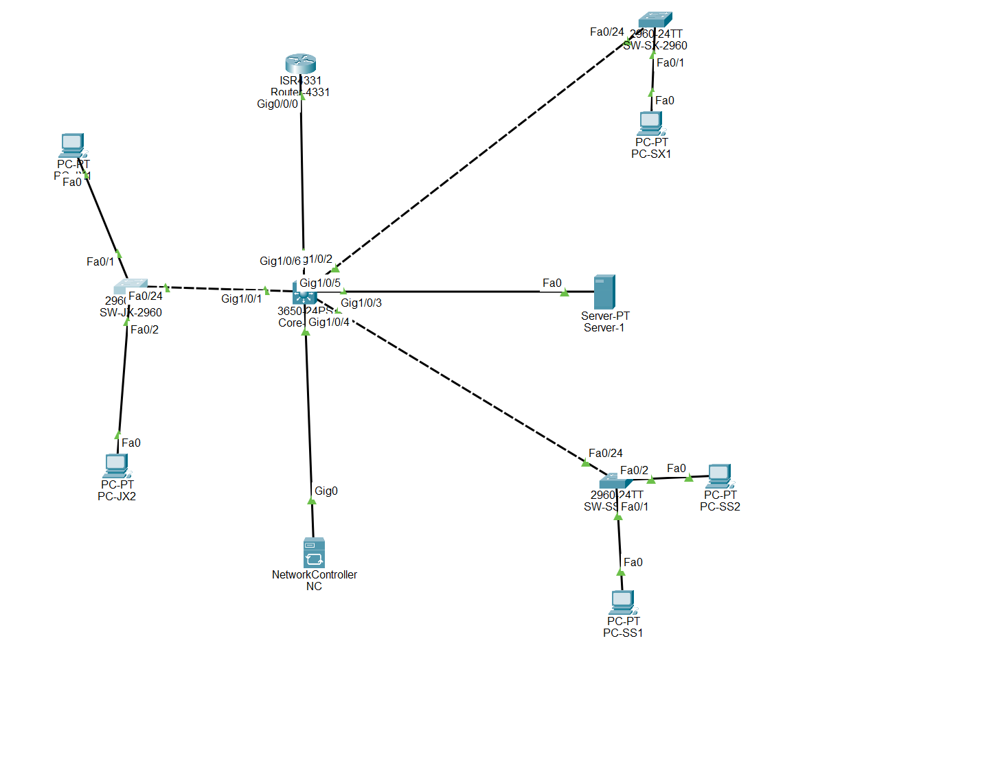

- 网络设备（5 台，全部被 NC 纳管为 Managed）：Router-4331（ISR4331）、Core-3650（3650-24PS）、SW-JX-2960 / SW-SX-2960 / SW-SS-2960（2960-24TT 接入交换机）
- 终端：6 台 PC（PC-JX1/JX2、PC-SX1、PC-SS1/SS2、PC-PT）+ Server-1
- 管理面：Network Controller（NC）通过 Gig0 接入 Core-3650，提供 Real World Access REST API（本项目真实数据源）
- 说明：PT 9.0 + NC，拓扑/端口/可达性均由 NC API 实时采集，非静态示意图

## 一、平台与真实数据

### 01 平台总览（真实数据源）

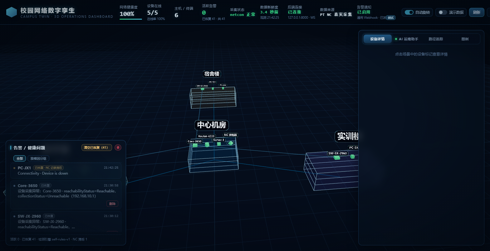

- 左上：网络健康度 100%、**5/5 设备在线**、6 台主机、活跃告警 0
- 右上：**数据来源 PT NC 真实采集**、采集状态 netcon 正常、数据新鲜度 1~3 秒、WebSocket 已连接
- 3D 场景：中心机房 / 教学楼 / 宿舍楼 / 实训楼 + 网络设备/主机图标
- 下方：告警面板（已恢复记录可删除/清空）

### 02 设备详情（点击设备）

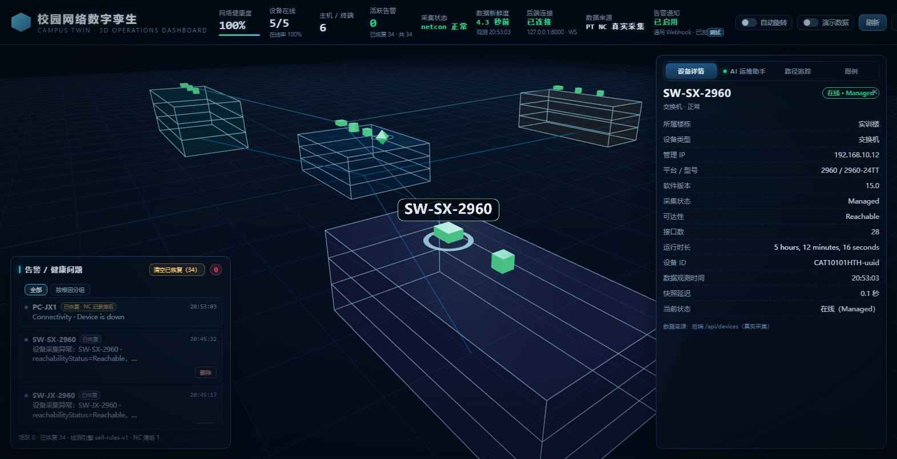

真实 NC 数据：设备型号、管理 IP、可达性、端口状态、关联主机。

### 03 告警管理与删除（W9）

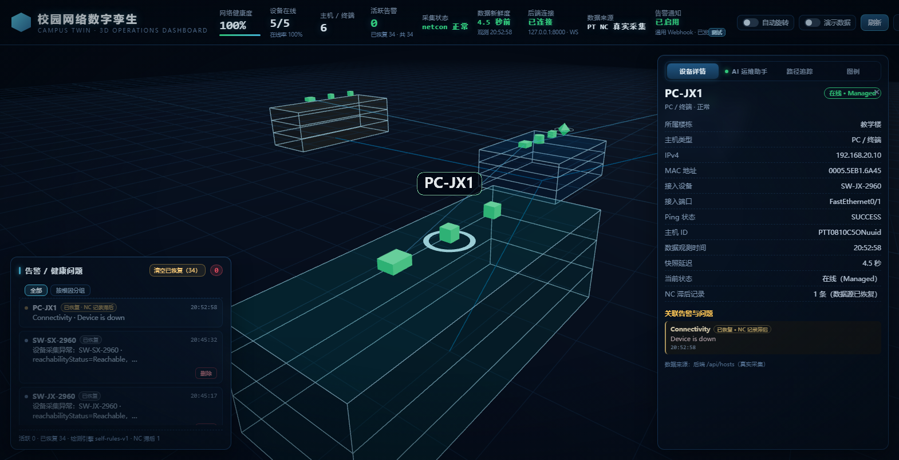

- 「清空已恢复（N）」按钮 + 单条「删除」按钮（软删除 + 审计 + 10 秒撤销）
- 活跃告警只能「静默」不能删除（防误删正在发生的故障）
- 标注「已恢复 · NC 记录滞后」：自建恢复判定不受 NC 3 分钟滞后影响

### 04 新设备自动发现（W9，⚠ Mock 状态图）

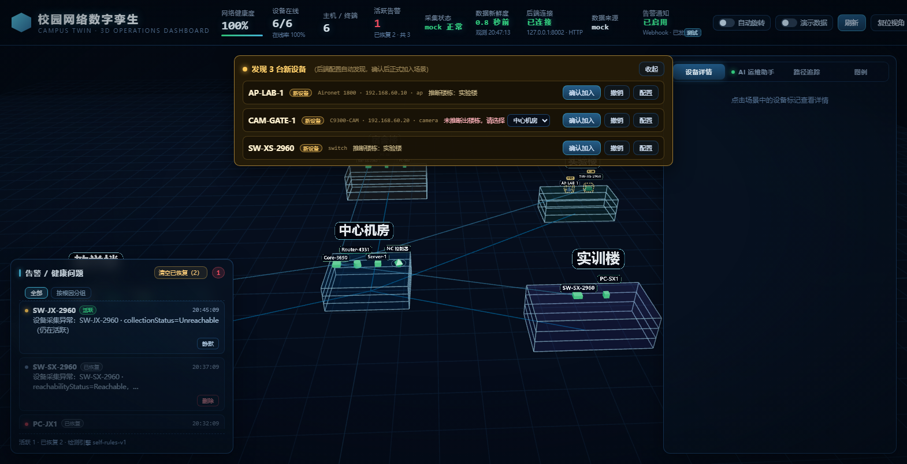

- PT 里加设备 → 后端采集发现 → 侦察 Agent 推断归属 → 场景自动出现新设备
- **说明**：此图为 Mock 契约模式的 UI 状态截图（真实链路已在 8101 实测通过，生产环境加设备即触发）

### 05 AI 多 Agent 执行轨迹

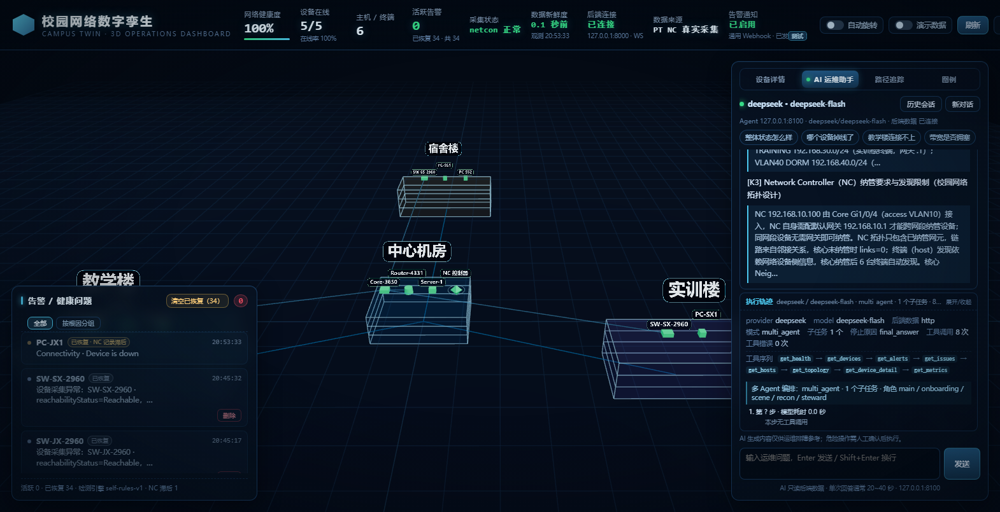

Agent 回答展开「执行轨迹」：provider/model、`multi_agent`、子任务计划、工具调用序列、耗时。

### 06 危险操作人工确认（W9，真实 Agent）

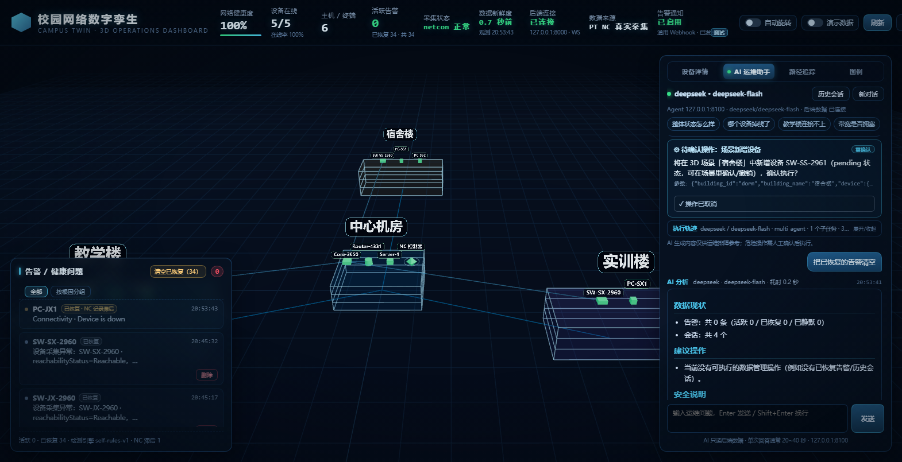

「清空已恢复告警」→ LangGraph `interrupt()` 暂停 → 红色危险卡片 → 取消后数据未变（实测 38 条告警一条没动）。

### 07 路径追踪 3D（W10，真实 NC flow-analysis）

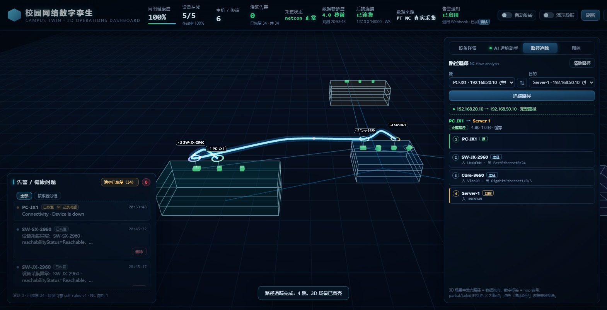

- 真实调用 NC `flow-analysis`：**PC-JX1 → SW-JX-2960 → Core-3650 → Server-1**（4 跳，约 1 秒）
- 3D 发光路径 + 方向脉冲 + 逐跳编号 + 端口列表
- PT 只返回部分中间设备 → 拓扑推断补全中间 hop（标 synthetic）

### 08 路径断点定位（⚠ Mock 状态图）

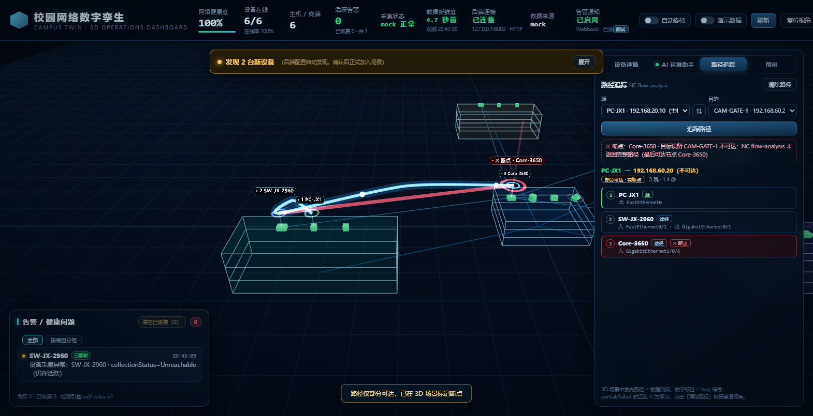

链路中断时返回 partial，断点最后一跳红色 ✕ + 红色末段 + 面板断点原因。

### 09 告警根因分组与抑制（⚠ Mock 状态图）

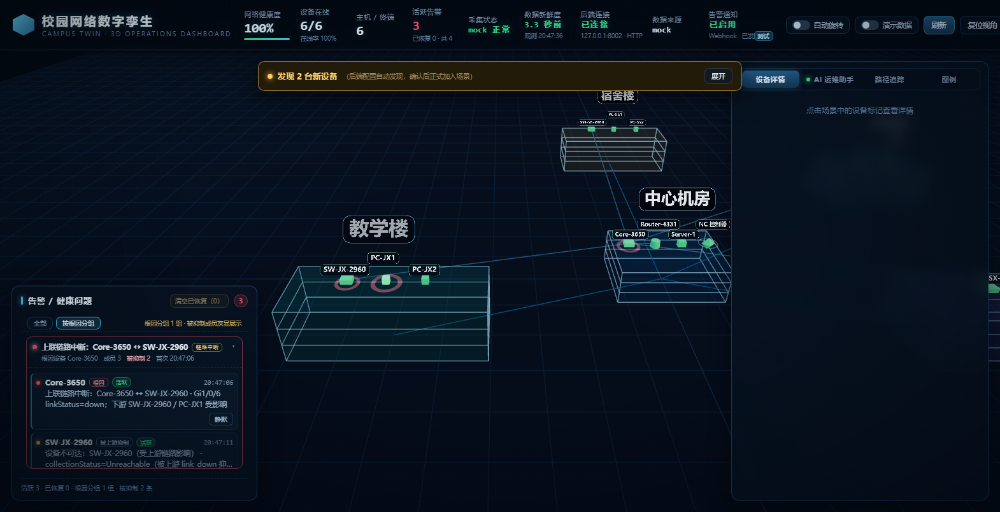

- 根因组卡片：「上联链路中断：Core-3650 ↔ SW-JX-2960」，成员 3、被抑制 2
- 下游告警灰显 +「被上游抑制」；根因成员标「根因」
- 说明：需要真实链路故障才有活跃告警，此图为 Mock 契约模式 UI 验证图

### 10 Agent 通过 MCP 读取真实配置文件（W13，真实）

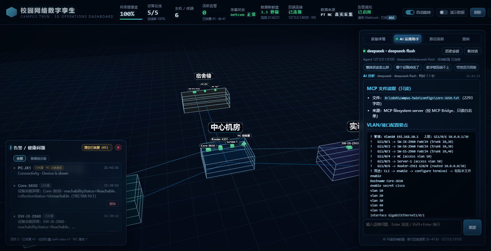

- 问「帮我读一下 configs/core-3650.txt 里 VLAN 配置」
- 链路：Agent → MCP Bridge（:8200）→ filesystem MCP Server（stdio）→ 真实文件
- 回答含真实 VLAN 10/20/30/40/50 与 trunk 配置；说明「只读白名单，写操作会被拒绝」

### 11 AI 流式输出（W12，真实）

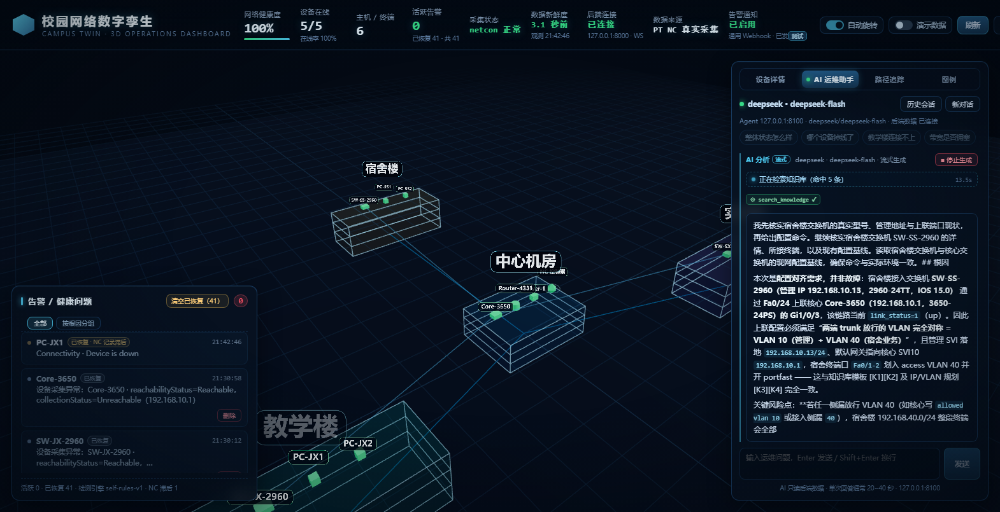

- SSE 逐 token 渲染中：状态条「正在检索知识库（命中 5 条）」+ `search_knowledge` 工具 chip + 停止生成按钮
- 真实 DeepSeek，回答内已出现 `[K1]~[K4]` 引用

### 12 RAG 引用（W12，真实）

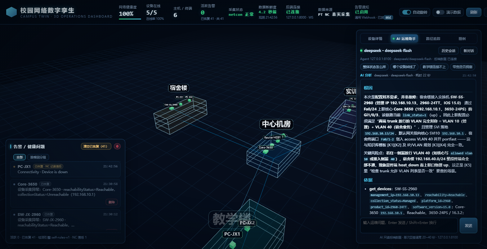

- 完整回答 + `[K1]~[K5]` 可点击引用角标 + 依据区引用真实设备/配置数据
- 知识库检索命中 5 条（配置模板 / IP-VLAN 规划 / 拓扑）

### 13 MCP 能力清单（W13，真实数据）

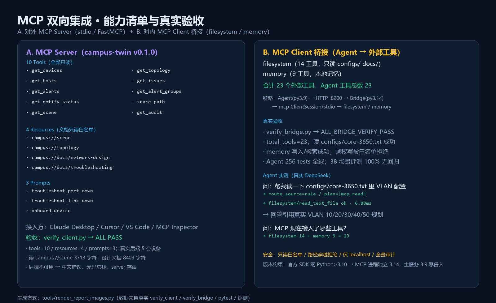

- A. 对外 MCP Server：10 tools / 4 resources / 3 prompts，`verify_client.py` ALL PASS
- B. 对内 MCP Client 桥接：filesystem 14 + memory 9 = 23 工具，`verify_bridge.py` ALL PASS
- Agent 实测：MCP 读文件 6.88ms、回答引用真实 VLAN 配置

### 14 测试与评测数据（真实）

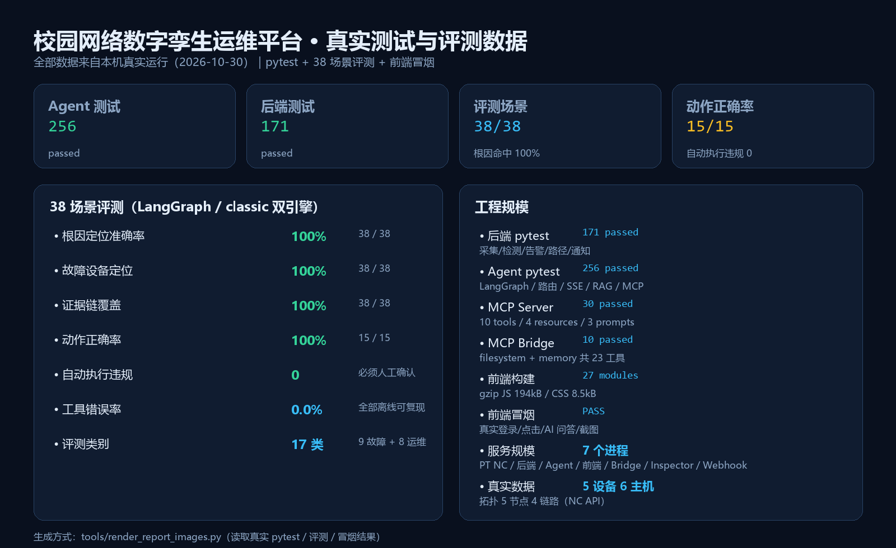

后端 171 tests / Agent 256 tests / MCP 30+10 tests；38 场景评测根因 100%、设备 100%、动作 15/15、自动执行违规 0。

### 15 系统架构图

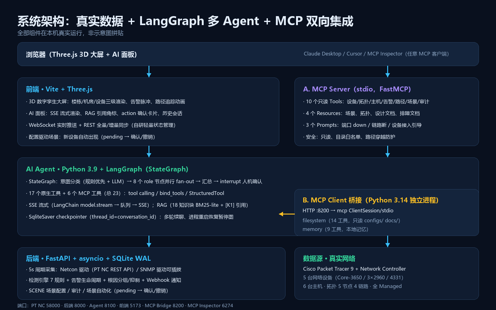

浏览器 → 前端（Three.js）→ Agent（LangGraph）→ 后端（FastAPI）→ 真实网络（PT NC）；
右侧为 MCP 双向：MCP Server（对外）+ MCP Client 桥接（对内）。

### 16 MCP Server 已连接（真实 MCP Inspector）

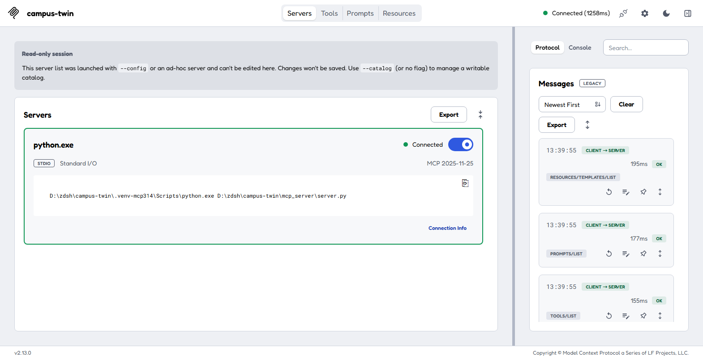

MCP Inspector 2.13：`campus-twin` server **Connected (1258ms)**，协议 `MCP 2025-11-25`，右侧消息流可见 `TOOLS/LIST`、`PROMPTS/LIST`、`RESOURCES/TEMPLATES/LIST` 全部 OK。

### 17 AI 真实问答排障（真实 DeepSeek）

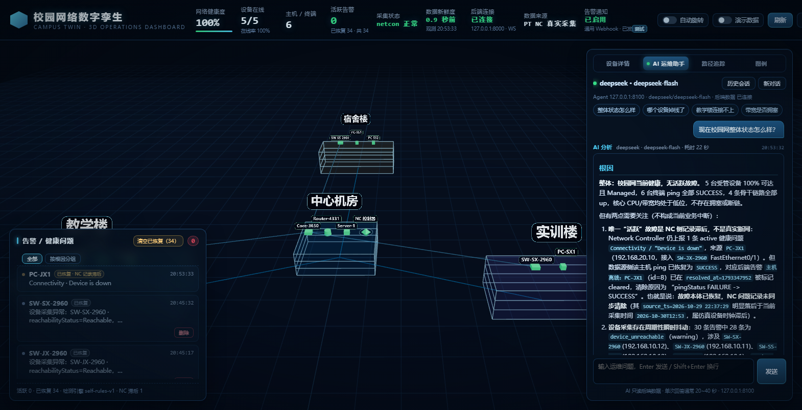

真实排障回答：根因、依据（设备/IP/端口/时间）、处置建议，危险操作走确认卡片。

---

## 二、截图使用建议

| 场景 | 建议用图 |
|---|---|
| 面试开场（30 秒介绍环境） | **00 PT 实验拓扑** + 01 总览 |
| 简历附件（1 页 PDF） | 00 拓扑 + 01 总览 + 07 路径追踪 + 14 数据卡 |
| GitHub README 顶部 | 01 总览 + 15 架构图 |
| 面试投屏（按顺序讲） | 00 → 01 → 06 危险确认 → 07 路径 → 11/12 流式+RAG → 16 MCP |
| 技术深度证明 | 15 架构 + 14 数据 + 13 MCP 清单 |

## 三、如何复现

```powershell
# 1. 启动全部服务（PT 需打开 campus-final.pkt 并启用 NC Real World Access）
cd D:\zdsh\campus-twin; .\tools\demo_start.ps1 -OpenBrowser

# 2. 数据卡 / 架构图 / MCP 清单（Pillow 渲染）
.\.venv\Scripts\python.exe tools\render_report_images.py

# 3. 大屏/AI/MCP 实时截图（headless Edge CDP）
cd frontend
node scripts/portfolio-shots.mjs        # 大屏、MCP 读配置、流式、RAG
node scripts/inspector-shot.mjs "<Inspector URL>"   # Inspector 连接截图

# 4. 全量 UI 截图（前端冒烟自带）
npm run smoke:w9 && npm run smoke
```

## 五、PDF 作品集（可直接发送）

- 📄 [校园网络数字孪生运维平台-作品集.pdf](校园网络数字孪生运维平台-作品集.pdf) —— **15 页**深色主题 PDF，含封面、PT 拓扑、系统架构、13 个功能页、技术栈与核心数据页
- 📊 [校园网络数字孪生运维平台-作品集.pptx](校园网络数字孪生运维平台-作品集.pptx) —— 同内容可编辑 PPTX 源文件（16:9）

生成方式（内容改动后重新生成）：

```powershell
# 1) 重新生成 PPTX（bundled Python，含 python-pptx）
& 'D:\dsh\dsh-runtimes\dsh-primary-runtime\dependencies\python\python.exe' tools\build_portfolio_pptx.py
# 2) PPTX → PDF（LibreOffice Kit）
& '<node>' '<libreoffice-kit cli.js>' convert --input "docs\校园网络数字孪生运维平台-作品集.pptx" --output "docs\校园网络数字孪生运维平台-作品集.pdf"
```

## 六、说明（诚实标注）

- 标注 **⚠ Mock 状态图** 的 3 张（04/08/09）为 Mock 契约模式下的 UI 状态截图，用于展示不依赖故障注入的界面状态；核心能力（路径追踪、MCP、流式、RAG、危险确认、多 Agent trace）均为**真实运行截图**。
- 所有截图无 PS 拼接；时间戳、数据新鲜度、协议耗时均为真实运行时采集。
