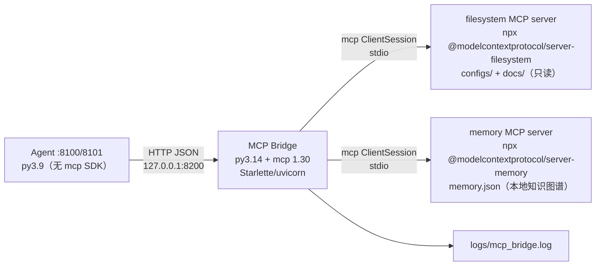

# campus-twin MCP Bridge（W13）

把外部 **MCP（Model Context Protocol）Servers** 接入 campus-twin Agent 的轻量 HTTP 桥。

- Agent（Python 3.9，**不装 mcp SDK**）→ HTTP → 本桥（Python **3.14** + `mcp 1.30.0`）
  → `mcp.ClientSession(stdio)` → Node MCP servers（filesystem / memory）。
- 桥只监听 `127.0.0.1:8200`；filesystem 只读白名单（configs/docs），所有调用写
  `logs/mcp_bridge.log`；桥不可用/工具报错时 Agent 侧工具返回 `ok=false` 中文提示，不崩、不编造。



## 启动

```powershell
cd D:\zdsh\campus-twin\mcp_bridge
# 首次启动 npx 会从 npmmirror 拉包；npm cache 已指向 workspace 内目录（config.json env）
D:\zdsh\campus-twin\.venv-mcp314\Scripts\python.exe bridge.py --port 8200
# 健康检查
Invoke-RestMethod http://127.0.0.1:8200/health
```

外部 servers（见 `config.json`）：

| server | 命令 | 白名单 |
|---|---|---|
| filesystem | `npx -y @modelcontextprotocol/server-filesystem D:\zdsh\campus-twin\configs D:\zdsh\campus-twin\docs` | 只读：read_text_file/read_file/read_multiple_files/list_directory/directory_tree/search_files/get_file_info/list_allowed_directories…（write/edit/move 全部拒绝） |
| memory | `npx -y @modelcontextprotocol/server-memory`（`MEMORY_FILE_PATH=mcp_bridge/data/memory.json`） | create_entities/create_relations/add_observations/read_graph/search_nodes/open_nodes 等本地记忆工具 |

> 注：本任务指定的 py3.14 venv 离线且未安装 FastAPI，桥使用 venv 已预装的
> **Starlette 1.10（ASGI）+ uvicorn**，HTTP 契约与 FastAPI 等价；`requirements.txt` 记录依赖。

## HTTP API

| 方法 | 路径 | 说明 |
|---|---|---|
| `GET` | `/health` | `{servers:[{name,connected,tools_count,error}], total_tools}` |
| `GET` | `/tools` | 全部工具 `{total, tools:[{server,name,description,input_schema}]}` |
| `POST` | `/call` | `{server, tool, arguments}` → `{ok, result, error, elapsed_ms}`（白名单外/未知 server/未连接均 `ok=false`，HTTP 200） |
| `GET` | `/` | 服务标识与端点 |

## 验证

```powershell
cd D:\zdsh\campus-twin\mcp_bridge
# 端到端：启动 bridge → 连接 npx servers → 列 tools → 读 configs/core-3650.txt → memory 写入/检索
D:\zdsh\campus-twin\.venv-mcp314\Scripts\python.exe verify_bridge.py
# 单测（stdlib unittest；pytest 兼容）
D:\zdsh\campus-twin\.venv-mcp314\Scripts\python.exe -m unittest discover -s tests -v
```

实测输出（节选）：

```
PASS /health: {"servers":[{"name":"filesystem","connected":true,"tools_count":14,...},
                            {"name":"memory","connected":true,"tools_count":9,...}], "total_tools":23}
PASS filesystem.read_text_file: core-3650.txt 前 6 行：! Core-3650 核心三层交换机 ...
PASS memory.create_entities + search_nodes
PASS 白名单拒绝 write_file
PASS 未知 server 错误处理
ALL_BRIDGE_VERIFY_PASS
```

## 安全

1. 仅监听 `127.0.0.1`（`bridge.py` 强制校验 host）；
2. filesystem 只读工具白名单；node server 目录白名单 `configs/`、`docs/`；
3. memory 只写本地 `data/memory.json`，不接触网络设备/生产库；
4. 每次调用记录 `logs/mcp_bridge.log`（server/tool/ok/elapsed/error），无 API key 输出；
5. Agent 侧工具全部只读语义（memory add 标注“仅本地记忆写入”，不生成 action）。

## 文件

```
mcp_bridge/
├── bridge.py            # MCP Client + HTTP 桥（Starlette/uvicorn）
├── config.json          # 外部 servers + 白名单 + env（NPM mirror/cache、MEMORY_FILE_PATH）
├── verify_bridge.py     # 端到端验证脚本
├── requirements.txt
├── README.md
├── data/                # memory.json + npm-cache（运行时生成，已 gitignore）
├── logs/                # mcp_bridge.log（已 gitignore）
└── tests/test_bridge.py # unittest（配置/归一化/白名单/HTTP 错误处理）
```
